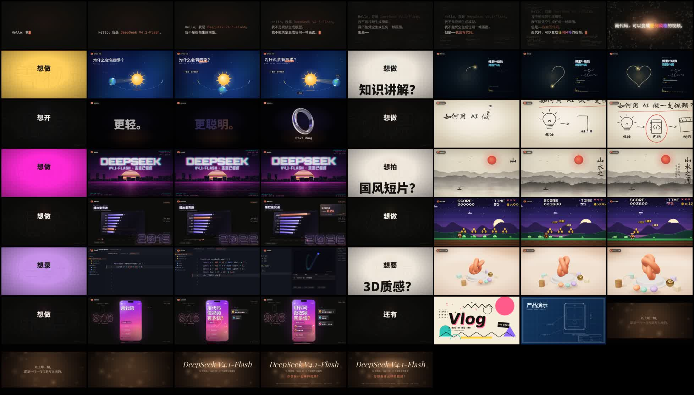
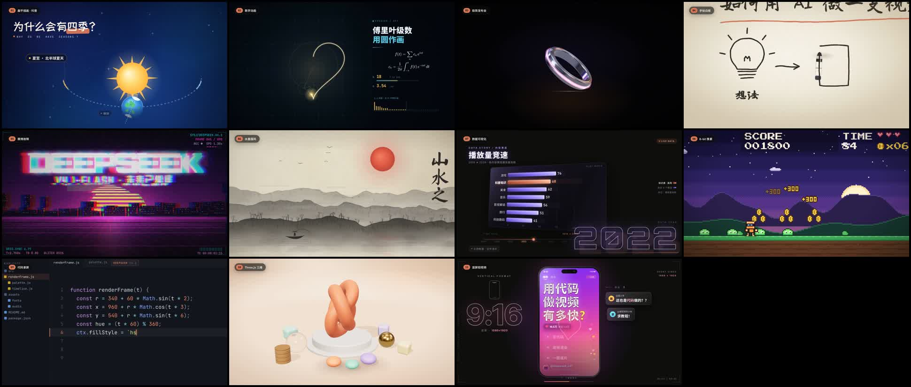
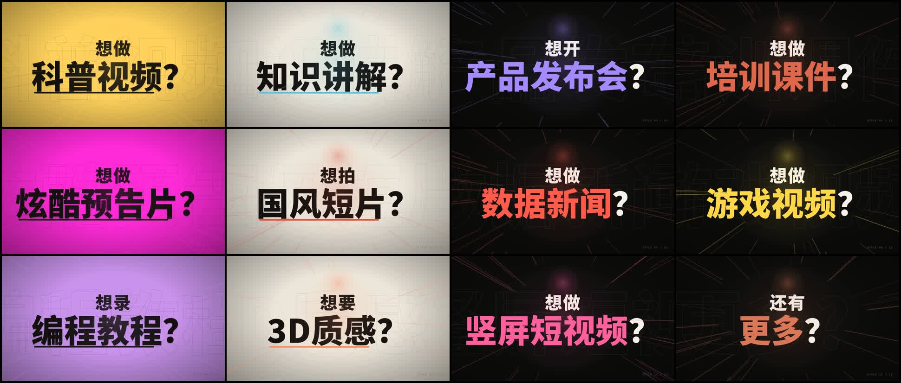
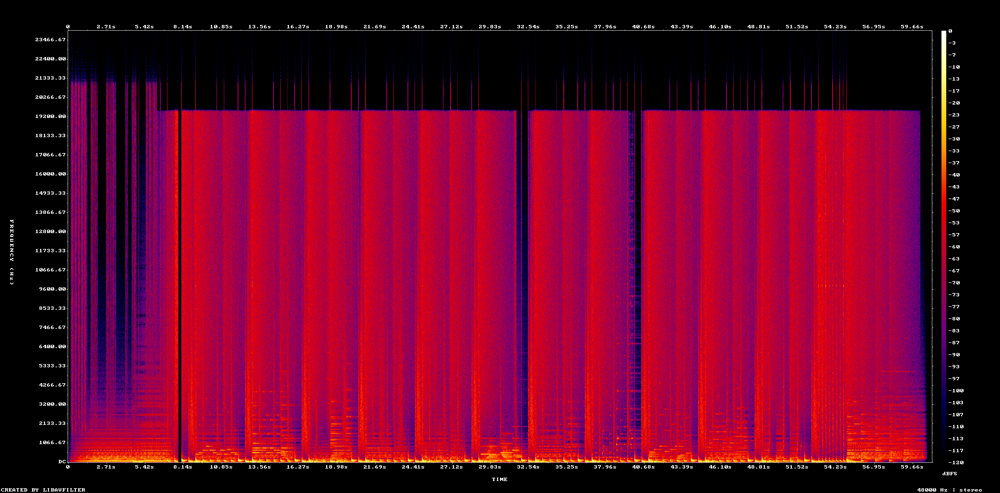
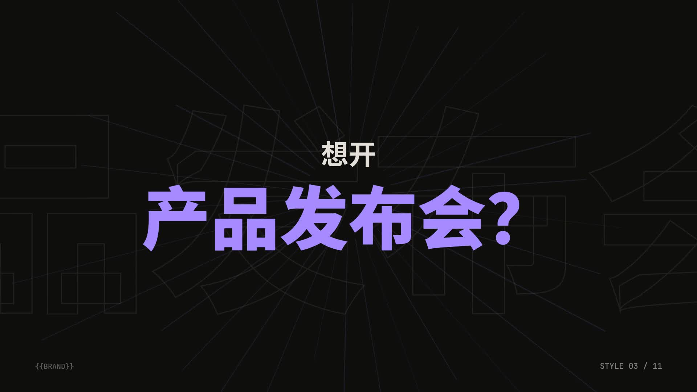
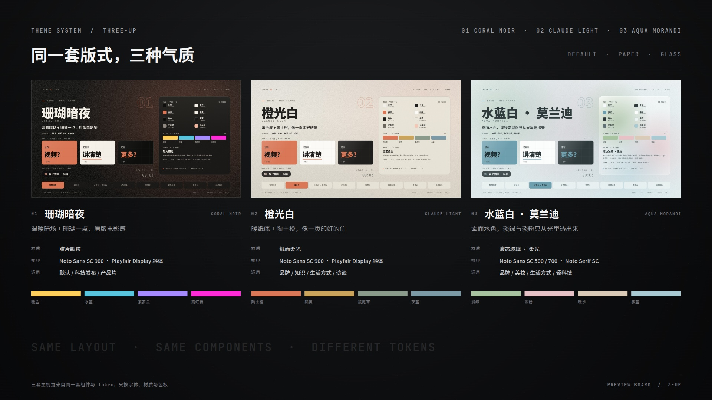
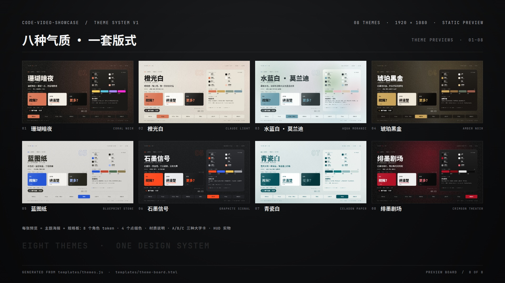
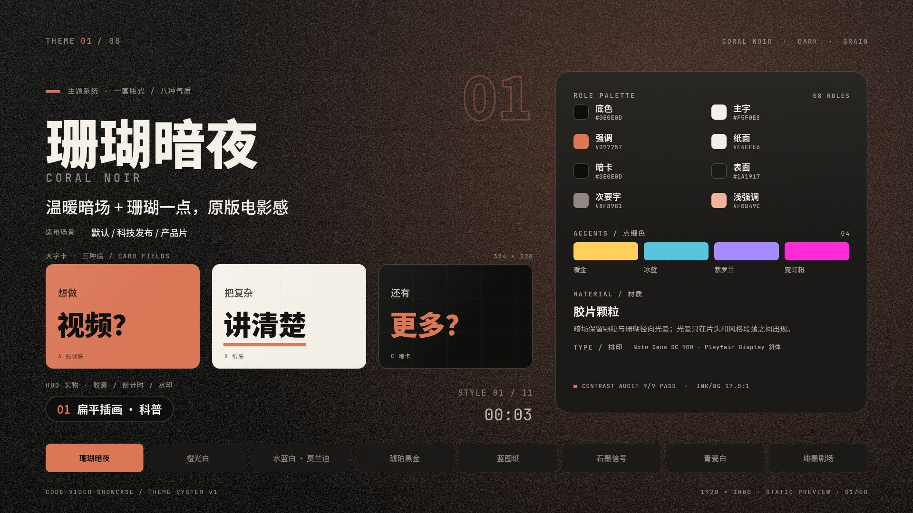

# code-video-showcase

**A pure-code, beat-synced showcase-video skill — every frame drawn with HTML/Canvas/SVG/Three.js, every sound synthesized with Python, assembled by FFmpeg. No video, image or music generation models.**

An Agent Skill for producing 30–90 s "style showcase" films: an 8 s opening, eleven style segments with 1 s big cards between them, an eight-flash montage, and a cinematic ending — all reproducible frame by frame.

> **中文简介**：这是一个「用代码做视频」的 Agent Skill：画面用 HTML/Canvas/SVG/Three.js 逐帧渲染，配乐用 Python（numpy/scipy）合成，最后由 FFmpeg 合成 30–90 秒的卡点风格展示片，全程不调用任何视频、图像或音乐生成模型。仓库里包含剪辑结构公式、11 种风格配方、大字卡系统、120 BPM 配乐方案、Playwright 渲染管线、质检清单和可运行模板。完整中文说明见 [中文](#中文)。

> **一键安装 / Install in one sentence**
>
> 把这句话发给你的 Agent：「把这个仓库安装成 Agent Skill：`git clone https://github.com/Moessif/code-video-showcase.git ~/.dsh/skills/code-video-showcase`（Claude Code 换成 `~/.claude/skills/`，通用 Agent 用 `.agents/skills/`），装好后读一遍 `SKILL.md` 确认可用。」
>
> Send this to your agent: "Install https://github.com/Moessif/code-video-showcase as an Agent Skill: clone it into `~/.dsh/skills/code-video-showcase` (`~/.claude/skills/` for Claude Code, `.agents/skills/` for generic agents), then read `SKILL.md` to confirm it works."

[](LICENSE)
[](https://nodejs.org/)
[](https://ffmpeg.org/)
[](#design-constraints)
[](https://github.com/Moessif/code-video-showcase/releases)

**Changelog / 更新历史**：[CHANGELOG.md](CHANGELOG.md) · [GitHub Releases](https://github.com/Moessif/code-video-showcase/releases)

> **Credits / 致谢**：This skill started from a prompt by the creator **Mixx.ftr** — this repository is an independent engineering reconstruction and extension of that prompt into runnable templates, themes and a deterministic render pipeline.
>
> 本技能最初起源于创作者 **Mixx.ftr** 的提示词，仓库是在其基础上做的工程化整理与扩展（模板、主题系统、预览与渲染管线）。

## Preview

> **There is no finished demo video in this repository**, and the reference sample file is not distributed. The previews are analysis artifacts of the 61 s reference showcase the skill was reverse-engineered from, plus a placeholder still rendered from the shipped big-card template.



*1 fps contact sheet (8×8 tiles) of the reference film: the typing opening, eleven big-card / style-segment rounds, the eight-flash montage and the ending. Generated by `scripts/analyze-reference.sh`.*



*One representative frame from each of the eleven style segments: flat-science, Fourier math, product launch, whiteboard, cyber glitch, ink-wash, data race, 8-bit, code screencast, Three.js clay, vertical short.*



*All twelve big cards — eleven "what do you want to make?" prompts plus the "还有更多?" card — across four alternating layouts: accent-colour, paper, dark centred, dark left-aligned.*



*Log-frequency spectrogram of the reference soundtrack: sparse intro (0–8 s), full-band groove from 8 s, visible 4 s structural seams, near-silent tail from 60.4 s.*



*`templates/big-card.html` rendered through `templates/render-segment.mjs` at 1920×1080: dark layout, "想开 / 产品发布会?" card, `STYLE 03 / 11`. Placeholder content — replace the copy, keep the timing.*

Theme previews are in [Themes](#themes): `assets/theme-previews/theme-three-up.jpg`, `theme-contact-sheet.jpg`, and per-theme stills `01-coral-noir.jpg` – `08-crimson-theater.jpg` (generated by `scripts/theme-preview.mjs`).

## What it is

The skill is a production recipe, not a model. It packages the structure measured off a real 61 s showcase: a timeline formula, a big-card system, eight theme palettes, eleven art-direction/technical/sound recipes, a 120 BPM synthesized score, a deterministic Playwright → FFmpeg pipeline, a QA checklist and runnable templates — full style palettes and six-beat animation maps live in `references/style-recipes.md`. Because every frame is a pure function of `t`, renders are deterministic: the same second always produces the same frame, on any machine.

### At a glance

| Property | Default target | Notes |
|---|---|---|
| Format | 1920×1080, 30 fps, 1× device scale | one HTML page per segment |
| Length | 61.0 s = 1830 frames | generalized by the formula below |
| Video | H.264 High, `yuv420p`, libx264, 2-pass ≈ 3.4 Mbps | final file ≈ 26 MB |
| Audio | 48 kHz stereo AAC 192 kbps | synthesized, no samples |
| Tempo | 120 BPM — 0.5 s per beat, 2 s per bar | 1 s card = 2 beats, 3 s style segment = 6 beats |
| Theme | 8 palettes, default `coral-noir` | omitting `?theme=` keeps the original coral `#d97757` on `#0e0e0d` visuals; see [Themes](#themes) |
| Type | OFL fonts only, served locally | Noto Sans/Serif CJK SC, Inter, JetBrains Mono, Orbitron, Playfair Display, Ma Shan Zheng, Long Cang, ZCOOL KuaiLe, ZCOOL QingKe HuangYou, Press Start 2P |
| Determinism | frame = f(t) | no CSS animation, rAF, `Date.now`, `Math.random`; no burned-in subtitles |

Measured on the reference sample: container 61.013 s / video 61.000 s, 1830 frames, 60 scene cuts, H.264 ≈ 3.53 Mbps, AAC 48 kHz stereo ≈ 196.8 kbps, 26.9 MB. Source data in `assets/scene-cuts.txt` and `assets/audio-analysis.json`.

### The timeline formula

```text
0 ── opening (O = 8 s) ── 8 ── N × 4 s rounds = 44 s ── 52 ── "还有更多?" card 1 s ── 53
  ── eight flashes 2 s (8 × 0.25 s) ── 55 ── ending (E = 6 s) ── 61

total = O + N·R + 1 + 2 + E          # 8 + 11×4 + 1 + 2 + 6 = 61 s
```

Each round `R = 4 s` = one big card (1 s / 2 beats) + one style segment (3 s / 6 beats). The first frame of every style segment is the beat hit. Frame check: each segment is `round(duration × 30)` frames and the whole film must total **1830**.

### The 10-stage workflow

1. **Lock the brief** — topic, brand placeholder `{{BRAND}}`, duration, number of styles `N`, one line per style, ending CTA.
2. **Write the edit table** — every segment as `[start, end, type, style, t0, speed]` in one JSON/Markdown constant file; all later scripts read it.
3. **Prepare the environment** — Node, Playwright/Chromium, FFmpeg, numpy + scipy, local fonts; see `references/render-pipeline.md` for the cross-platform setup.
4. **Scaffold the project** — static server, `common.js`, segment / card / render / concat / audio templates.
5. **Implement segments one at a time** (an 11-segment outer loop): scene → 5–6 stills → contact sheet → full render → `ffprobe` frame count.
6. **Opening (8 s)** — character-by-character typing, three scrolling code columns, particle burst, white flash.
7. **Big cards** — four layouts rotating, 2 beats each: slam-in, speed lines, echo type, `STYLE 0X / 11`.
8. **Eight flashes + ending (optional)** — eight 0.25 s micro-posters, then a 6 s cinematic ending.
9. **Score the film** — 120 BPM, A minor, sharing the exact timing constants of the edit table; verify against a spectrogram.
10. **Assemble and QA** — segment MP4s → concat → mux → 2-pass encode → contact sheets + spectrogram + human review.

The mandatory inner loop for every segment:

```text
design -> write HTML -> stills at t=0.2/0.8/1.4/2.0/2.6 -> contact sheet
       -> full render -> ffprobe frames == duration*30 -> log -> next segment
```

Do not write all eleven segments and then render once; get one segment perfect and copy it.

### Big-card system (1 s / 2 beats)

| Layout | Background | First line | Keyword | Underline |
|---|---|---|---|---|
| A | accent colour | black 70 px | black 170 px | black 8–12 px |
| B | paper `#f4efe6` | black 70 px | black 170 px | accent 8–12 px |
| C | dark `#0e0e0d`, centred | white 70 px | accent 170 px | none |
| D | dark `#0e0e0d`, left-aligned | white 70 px | accent 170 px | none |

- Beat 1 (`t=0`): first line slams in; beat 2 (`t=0.5`): keyword + suffix slams in.
- Slam = scale `1.7 → 1`, blur `16 → 0` px, 0.11 s, `outExpo`; plus accent speed lines, radial glow and 6 px / 12 px screen shake.
- Background: 600 px outlined echo text drifting horizontally; `STYLE 0X / 11` bottom-right; music drops to 6% during the card, then the style segment opens with its own hit.
- Pre-render blur layers once and cross-fade with `globalAlpha` — never run `ctx.filter` per frame.

### The 120 BPM soundtrack

Pure numpy/scipy synthesis — no samples, no audio model:

- **Instruments**: kick (sine sweep), snare, clap, hat, crash, sub boom, noise riser, reverse crash, whoosh, plucked string, FM e-piano, FM bell, supersaw, 808, square/triangle leads, flute.
- **Harmony**: A minor, one chord pair per 6-beat segment — Am/F, C/G, F/G, C/F, Am/G, Am/Em, Dm/E, C/G, Dm/G, F/G, Am/F.
- **Arrangement**: pad + typing clicks → sub boom at 4.55 s, kick crescendo → 8th hats from 5.5 s → snare roll 6.5–7.95 s → reverse crash at 7.45 s. Cards drop the music to 6%; the first frame of each style segment is a six-layer hit.
- **Mix**: kick-envelope sidechain (55% duck), 2.2 s synthetic convolution reverb, `tanh` soft clip, normalize to −0.6 dBFS.
- **Reference measurements**: 120.0 BPM, phase 0.0 s, 86.3% of 102 strong onsets inside ±30 ms of the grid (median error 0 ms); card hits measure 8–9× the previous 300 ms of energy, style-segment hits 2.8–3.5×.

### Rendering pipeline

1. Serve the project root over HTTP (fonts, KaTeX and Three.js all same-origin; never `file://`).
2. `render-segment.mjs` launches headless Chromium, waits for `document.fonts.ready` and `window.__ready`, then for each frame calls `page.evaluate(t => renderFrame(t))`, captures via CDP `Page.captureScreenshot({ format: 'jpeg', quality: 95 })`, and pipes the JPEGs to `ffmpeg -f image2pipe -framerate 30 -i pipe:0 -c:v libx264 -preset medium -crf 16 -pix_fmt yuv420p`.
3. `concat-and-encode.sh` concatenates segment MP4s (`-f concat -safe 0 -c copy`), muxes the WAV, and runs a 2-pass encode at 3400 kbps with AAC 192 kbps.
4. Every segment is verified with `ffprobe -count_frames`; the total must equal 1830.

### QA checklist

**Picture** — no console errors, no 404s (including favicon); every font passes `document.fonts.check()` with no missing CJK glyphs; 5–6 stills per style segment and a 1 fps contact sheet for the whole film; grep proves no CSS animation/rAF/`Date.now`/`Math.random`; no per-frame `ctx.filter` or large `shadowBlur`; coordinates cached before camera transforms (`getBoundingClientRect` is affected by transforms); 1920×1080 at 1×, `preserveDrawingBuffer: true`, WebGL via SwiftShader.

**Audio** — spectrogram shows every hit within 30 ms of the edit table; cards drop out, style segments hit on frame one; 5.5–6.0 s fade-out; peak −0.6 dBFS with no clipping.

**Assembly** — every segment's frame count equals `duration × 30`, total 1830; audio and video aligned (`-shortest`, `-t 61` if needed); H.264 `yuv420p` + AAC 48 kHz, ≈ 26 MB; a cover frame is extracted and a one-page spec sheet (frame rate / duration / styles / fonts / toolchain) is written.

## Themes

A theme is not three swapped colours: it is a role palette (14 tokens), one background material, HUD specs and four accent colours. Eight themes ship in `templates/themes.js`; **omitting `?theme=` renders the original `coral-noir` visuals, pixel for pixel**.

| # | id | Name | Mode | Material | Best for |
|---|---|---|---|---|---|
| 01 | `coral-noir` | Coral Noir / 珊瑚暗夜 | dark | film grain | default / product & tech launch |
| 02 | `claude-light` | Claude Light / 橙光白 | light | warm paper | brand / knowledge / interview |
| 03 | `aqua-morandi` | Aqua Morandi / 水蓝白·莫兰迪 | light | liquid glass · soft light | beauty / lifestyle / light tech |
| 04 | `amber-noir` | Amber Noir / 琥珀黑金 | dark | brushed foil | premium / luxury / annual film |
| 05 | `blueprint-stone` | Blueprint Stone / 蓝图纸 | light | blueprint grid | engineering / architecture / data |
| 06 | `graphite-signal` | Graphite Signal / 石墨信号 | dark | matte industrial | developer / hardware / hard tech |
| 07 | `celadon-paper` | Celadon Paper / 青瓷白 | light | ink wash | oriental / culture / minimal |
| 08 | `crimson-theater` | Crimson Theater / 绯墨剧场 | dark | stage spotlight | fashion / art / teaser / mood |



*Three featured themes side by side: coral-noir (default), claude-light, aqua-morandi.*



*Contact sheet of all eight themes. Per-theme stills: `assets/theme-previews/01-coral-noir.jpg` … `08-crimson-theater.jpg`.*



*`coral-noir` — the default theme, identical to the pre-theme visuals.*

Pick a theme through the query string. Both templates read it with `themeFromURL()`; aliases work (`?theme=aqua`, `?theme=claude`, `?theme=珊瑚`) and an unknown value falls back to `coral-noir`:

```bash
# style segment (relative --page keeps ?theme=; the renderer appends seg/t0/speed/dur)
node render-segment.mjs --page /segments/01.html?theme=aqua-morandi --out out/01.mp4 --duration 3

# big-card stills
node render-segment.mjs --page /big-card.html?theme=graphite-signal --still 0.5,1.0 --outdir out/stills
```

Theme choice is an intake decision, not a rendering tweak: collect the brief with `references/intake.md` (at most two rounds, lock the theme, write `brief.json`), then read the full spec in `references/themes.md`. Audit every palette change with `node scripts/theme-audit.mjs --strict` — all eight themes pass today. For a real brand colour use `accentOverride(themeRef, input)` in `themes.js` and store the returned `override` in `brief.json`; do not invent a ninth theme.

## Quick start

The templates are a scaffold, not a finished film. From this repository:

```bash
# 0) intake first — collect the brief, lock the theme, write brief.json (references/intake.md)
#    pick a theme from assets/theme-previews/theme-contact-sheet.jpg (or re-render previews in step 3)

# 1) create a project and copy the templates into it
mkdir -p my-showcase/segments my-showcase/shared my-showcase/fonts my-showcase/audio my-showcase/out
cp templates/* my-showcase/
cp scripts/* my-showcase/
cp my-showcase/segment.html my-showcase/segments/01.html    # your first style segment
cp my-showcase/common.js my-showcase/themes.js my-showcase/segments/   # segment.html imports ./common.js and ./themes.js

# 2) install the renderer inside the project (theme previews need it too)
(cd my-showcase && npm i playwright)   # or playwright-core; the renderer accepts either

# 3) optional: render the eight theme previews + contact sheet (run from the repo root)
node scripts/theme-preview.mjs --root my-showcase

# 4) draft stills first (cheap) — t=0.2,0.8,1.4,2.0,2.6
cd my-showcase
node render-segment.mjs --page /segments/01.html?theme=aqua-morandi --still 0.2,0.8,1.4,2.0,2.6 --outdir out/stills

# 5) render one 3 s segment; the renderer starts its own ephemeral static server
node render-segment.mjs --page /segments/01.html?theme=aqua-morandi --out out/01.mp4 --duration 3

# 6) verify segment frame counts (h264 / yuv420p / 1920x1080 / fps / frames)
./qa-check.sh out 30

# 7) synthesize the soundtrack (8 s demo out of the box)
python3 synth_audio.py --out audio/demo.wav

# 8) concat + mux + 2-pass encode (defaults: duration 61, 30 fps, 3400 kbps, AAC 192k)
./concat-and-encode.sh segments.txt audio/mix.wav out/final.mp4
```

`segments.txt` is the concat demuxer list, one line per segment:

```text
file 'out/00-opening.mp4'
file 'out/01-card.mp4'
file 'out/02-style-01.mp4'
...
```

Notes:

- `render-segment.mjs` embeds a small static server, so a local **path** is enough (`--page /segments/01.html`); a full URL is used verbatim. Style segments take `--t0 0.35 --speed 1.4` — for a relative page the renderer appends `?seg=1&t0=&speed=&dur=`, and `common.js` maps clip time `u` to scene time `t = t0 + u·speed`.
- Rendering needs no separate server: the renderer embeds one. For manual browser previews only, serve the project root on port 4600 yourself — `references/render-pipeline.md` §3 documents an optional `tools/server.mjs` (`node tools/server.mjs --port 4600`) that is not shipped, because the renderer already contains an equivalent. To click through the theme boards interactively, serve the templates directory instead: `python3 -m http.server -d templates 4600`, then open `http://localhost:4600/theme-board.html?theme=aqua-morandi` (the boards import `./themes.js` as a module, so `file://` will not work).
- The templates expect a local `shared/fonts.css` with `@font-face` rules for OFL fonts you download yourself. Fonts are not bundled.
- Useful env vars: `CHROME_EXE` / `FFMPEG_EXE` for the renderer; `FFMPEG` / `FFPROBE` / `VIDEO_BITRATE` / `AUDIO_BITRATE` for the shell scripts (plus `PYTHON` for `qa-check.sh`). `node render-segment.mjs --help` lists every flag.
- `synth_audio.py` is a toolkit plus a runnable 8 s demo; extend `build_arrangement()` to the full 61 s timeline using `references/audio-recipes.md`.

## Install as an Agent Skill

The repository is a self-contained skill folder: `SKILL.md` carries the YAML frontmatter (`name`, `description`, `license: MIT`, `compatibility`, `allowed-tools`) and the code agent reads it before acting.

```bash
# DeepSeek Harness
cp -r code-video-showcase ~/.dsh/skills/

# Claude Code
cp -r code-video-showcase ~/.claude/skills/

# Generic SKILL.md-compatible agents
cp -r code-video-showcase .agents/skills/
```

Once installed, the skill auto-triggers on prompts such as 卡点视频 / 风格展示视频 / 纯代码做视频 / 「类似 Opus 5.5 或 DeepSeek 风格展示」 / 逐帧渲染 / 用代码做视频 / HTML Canvas 视频 / 程序化视频 — and on the English equivalents ("beat-synced showcase video", "render video frame by frame in code"). The agent then follows the ten-stage workflow, copies the templates and renders locally.

## Requirements

| Component | Requirement | Why |
|---|---|---|
| Node.js | ≥ 20 (24 recommended) | renderer script + `playwright` |
| npm packages | `playwright` or `playwright-core` (optional: `katex`) | headless Chromium driver, browser |
| Browser | Playwright bundled Chromium, Chrome for Testing, or Edge | frame capture; WebGL via SwiftShader args |
| FFmpeg + ffprobe | libx264, AAC, `image2pipe`; `tile`/`showspectrumpic` for analysis | encode, concat, 2-pass, contact sheets, spectrogram |
| Python | ≥ 3.10 with numpy + scipy | soundtrack synthesis, audio analysis, QA script |
| Fonts | all OFL, downloaded and served locally | CJK + display type; no CDN at render time |

### Platform notes

- **Windows**: the renderer tries `CHROME_EXE` if set, then Playwright's bundled Chromium, then Edge (`channel: 'msedge'`); set `CHROME_EXE` to point at a specific build.
- **WSL / Linux**: if the bundled download is slow, use Chrome for Testing and `executablePath`; headless Chromium may need `libnss3/libnspr4/libasound2`, obtainable without root via `apt-get download` + `dpkg-deb -x` into `~/.local/opt/chromium-libs` and `LD_LIBRARY_PATH`.
- Keep `node_modules`, Python venvs, browser caches and scratch frames on the Linux filesystem: in the reference measurements `/mnt/e` wrote ~2000 small files in ~4.9 s versus ~0.05 s on ext4. Frames are piped straight to ffmpeg and never hit disk; rendering is local and CPU-bound, with no cloud service or generation API involved.

## Repo structure

```text
code-video-showcase/
├─ SKILL.md                          # the skill itself — workflow, constraints, index
├─ README.md                         # this file
├─ LICENSE                           # MIT
├─ .gitignore / .gitattributes       # ignore build output / enforce LF line endings
├─ references/
│  ├─ intake.md                      # pre-flight brief intake + theme lock (brief.json)
│  ├─ original-brief.txt             # the original 61 s brief — copy and rebrand
│  ├─ reference-film-analysis.md     # measured breakdown of the reference (cuts/frames/audio)
│  ├─ style-recipes.md               # 11 styles: art direction + technique + sound
│  ├─ themes.md                      # theme system: palettes, materials, HUD, cardColors, QA
│  ├─ big-card-and-typography.md     # 4 card layouts, type scale, slam parameters
│  ├─ audio-recipes.md               # 120 BPM arrangement, synthesis formulas, mix chain
│  └─ render-pipeline.md             # Playwright / FFmpeg / cross-platform setup and commands
├─ templates/
│  ├─ common.js                      # easing, seeded random, noise/fbm, segment mode, impact
│  ├─ themes.js                      # 8 themes: palettes, materials, HUD, cardColors/chrome/accentOverride
│  ├─ segment.html                   # style-segment skeleton (Canvas + optional Three.js)
│  ├─ big-card.html                  # big-card skeleton (4 layouts, slam, echo type)
│  ├─ theme-board.html               # single-theme preview board (?theme=<id>, 1920×1080)
│  ├─ render-segment.mjs             # frame-by-frame renderer -> ffmpeg image2pipe
│  ├─ concat-and-encode.sh           # concat + mux + 2-pass encode
│  └─ synth_audio.py                 # numpy/scipy instrument library + arrangement demo
├─ scripts/
│  ├─ analyze-reference.sh           # any reference MP4 -> contact sheet/cuts/spectrogram/analysis
│  ├─ theme-preview.mjs              # render the eight theme previews, contact sheet and three-up
│  ├─ theme-audit.mjs                # theme contrast audit (--strict for CI)
│  └─ qa-check.sh                    # verify segment MP4s (codec/pix_fmt/size/fps/frame count)
└─ assets/                           # evidence images and measured data
   ├─ contact-1fps.jpg               # 1 fps contact sheet of the 61 s reference
   ├─ opening-tiles.jpg / style-tiles.jpg / card-tiles.jpg / flash-tiles.jpg / ending-tiles.jpg
   ├─ template-demo-segment.jpg / template-demo-card.jpg   # stills rendered from the templates
   ├─ audio-spectrogram.png          # log-frequency spectrogram
   ├─ theme-previews/                # 8 theme stills + contact sheet + three-up (see Themes)
   └─ audio-analysis.json / scene-cuts.txt / colors-per-second.json   # measured data
```

## The 11 styles

| # | Style | Core technique | Key elements | Signature sound |
|---|---|---|---|---|
| 01 | Flat-science explainer | Canvas 2D layered circles / triangles / dashed orbit | sun, earth, light beam, label capsules | marimba |
| 02 | Math animation | Canvas 2D + DFT epicycles + KaTeX | golden heart, formulas, live N/θ | FM e-piano arpeggio + pad |
| 03 | Minimal product launch | canvas type + Three.js `LatheGeometry` | metal ring, LED halo, "Nova Ring" | per-beat sub + bells |
| 04 | Hand-drawn whiteboard | SVG `stroke-dashoffset` + turbulence | bulb → code → clapper, red circle | ukulele + marker noise |
| 05 | Cyber glitch | Canvas gradients / perspective grid + RGB split | striped sun, city, glitch slices | distorted 16th saw + four-on-the-floor |
| 06 | Ink-wash (guofeng) | Canvas fbm ridges + paper texture | mountains, red sun, boat, vertical calligraphy | guzheng pentatonic + taiko + flute |
| 07 | Data visualisation | Canvas bar race + CSS 3D perspective | bars, year counter, glass card | square arpeggio + ticks |
| 08 | 8-bit pixel | 240×135 canvas, pixelated 8× | robot, coins, slime, pixel HUD | chiptune + jump/coin SFX |
| 09 | Code screencast | Canvas editor + typed code | file tree, line numbers, live preview | lo-fi e-piano + vinyl noise |
| 10 | Three.js 3D | `Lathe`/`TorusKnot` + `PhysicalMaterial` | clay studio, glass and metal spheres | bell arpeggio + boings |
| 11 | Vertical short | Canvas phone frame + pop-in UI | 9:16, step cards, comments and likes | 808 + supersaw + trap hats |

Every style segment carries the same chrome: a top-left capsule with the themed index number (coral in the default theme) and style name, a bottom-right 3-second countdown, a faint brand watermark, one or two in-style labels, and no bottom subtitles.

Each of the eleven segments keeps its own palette by default; the theme unifies the film through capsule/HUD chrome, `cardColors()` and `theme.accents` rather than repainting every segment — see the last section of `references/style-recipes.md`.

## Design constraints

- **Deterministic frames.** Every frame is a pure function of `t`. Forbidden: CSS `transition`/`animation`, `requestAnimationFrame` in the page, `Date.now()`, `performance.now()`, `Math.random()`. Use `mulberry32(seed)` and value noise/fbm instead.
- **The renderer drives time.** A page exposes `window.DURATION`, `window.renderFrame(t)`, `window.__ready` (and optionally `window.__bootError`); the renderer calls `renderFrame(i/fps)` — the page never schedules itself.
- **No baked subtitles.** All text is part of the composition (capsules, HUD, labels); bottom subtitle bars are banned.
- **Themes are data.** Every colour comes from `templates/themes.js` (`?theme=` → `chrome(theme)`, `cardColors(theme, layout)`, `drawThemeBackground`); never hard-code `#d97757` in a page.
- **WebGL specifics.** `{ preserveDrawingBuffer: true }`, launch flags `--use-angle=swiftshader --enable-webgl --ignore-gpu-blocklist --enable-unsafe-swiftshader`, camera motion by parameter, never by wall clock.
- **Cheap frames.** Pre-render blur/noise/paper layers once, cross-fade with alpha, and inspect five stills before a full render; avoid per-frame `ctx.filter` and wide `shadowBlur` (per-frame filters are 10×+ slower under software rendering); cache layout coordinates before camera transforms.
- **One page, one segment.** No shared runtime state between pages; visuals and audio import the same timeline constants.
- **OFL fonts only, served locally.** Load with `document.fonts.load(...)` for every family and weight, then `document.fonts.ready`, then set `window.__ready`.

## License & credits

Released under the **MIT License** — see [LICENSE](LICENSE).

Credits and provenance:

- The structure, timing and visual grammar come from a frame-by-frame analysis of a 61 s reference style-showcase video. The analysis is documented in `references/reference-film-analysis.md`, with evidence in `assets/`.
- **Original prompt credit:** the seed prompt behind this skill came from the creator **Mixx.ftr**; the templates, theme system, preview tooling, render pipeline and QA checklist in this repository are an independent engineering extension built on top of it.
- The production brief that this skill operationalizes is included verbatim as `references/original-brief.txt`.
- No third-party code or media assets are bundled. All artwork is meant to be drawn at runtime; the soundtrack is synthesized.
- Fonts are **not** bundled — download OFL-licensed font files yourself and serve them locally.
- The coral `#d97757` brand colour and the sample copy are placeholders; replace them with your own brand and script.

## Language

This README is bilingual: English first, Chinese below. `SKILL.md` itself is written in Chinese and is the authoritative source for the workflow. [跳到中文](#中文).

## 中文

**这是一个「用代码做视频」的 Agent Skill：** 画面由 HTML/Canvas/SVG/Three.js 逐帧绘制，配乐由 Python（numpy/scipy）纯合成，最后交给 FFmpeg 合成 30–90 秒的卡点风格展示片。全程不调用任何视频、图像或音乐生成模型，每一帧都是时间 `t` 的纯函数，可复现、可逐帧检查。

### 这个项目是什么

它不是模型，而是一套可复用的制作方法。内容来自对一支 61 秒风格展示样片的逐帧拆解：剪辑结构公式、4 套大字卡版式、11 种风格的「美术 + 技术 + 音色」配方、120 BPM 配乐、Playwright 逐帧渲染管线、质检清单，以及可直接运行的模板。样片的结构是固定句式：开场 8 秒 → 11 轮 × 4 秒（大字卡 1 秒 + 风格段 3 秒）→ 「还有更多?」卡 1 秒 → 八连闪 2 秒 → 结尾 6 秒，合计 61 秒 / 1830 帧。公式可推广到任意风格数 `N`，30–90 秒的短片都能套用。

### 仓库里有什么

- **十阶段工作流**：从需求定稿、剪辑表、环境准备，到逐段实现、配乐、合成与质检（见 `SKILL.md`）。
- **时间结构公式**：总时长 = `O + N·R + 1 + 2 + E`；每段帧数 `round(duration × 30)`，全片合计必须为 1830。
- **大字卡系统**：强调色底 / 米白底 / 黑底居中 / 黑底左对齐 4 套版式；砸入缩放 1.7→1、模糊 16→0 px、0.11 秒 `outExpo`；速度线、径向光晕、6/12 px 抖动、600 px 描边回声字。
- **8 套主题配色**：珊瑚暗夜（默认，与原版逐值一致）、橙光白、水蓝白·莫兰迪、琥珀黑金、蓝图纸、石墨信号、青瓷白、绯墨剧场。一套主题 = 角色色板 + 材质 + HUD 规格 + 点缀色；数据源 `templates/themes.js`，规范见 `references/themes.md`，选主题走 `references/intake.md`。
- **11 种风格配方**：每种都给出调色板、构图、6 拍动效表、技术实现要点和专属音色。
- **120 BPM 配乐方案**：A 小调、纯 numpy/scipy 合成；大字卡音乐压到 6% 形成 drop-out，风格段第一帧是六层叠加的「啪」；侧链 55%、2.2 秒混响、`tanh` 软削波、归一化到 −0.6 dBFS。
- **渲染管线与质检**：服务器 → Playwright 无头 Chromium → CDP 截帧 JPEG q95 → `image2pipe` → libx264 crf16 → concat → 2-pass 3400 kbps + AAC 192k；质检覆盖画面、音频、合成三组检查项，外加 1 fps 接触表、频谱图与 `ffprobe` 帧数复核。
- **参考样片拆解与原始任务书**：`references/reference-film-analysis.md` 记录实测切点、画面与音频数据；`references/original-brief.txt` 是可改品牌直接复用的完整任务书。

### 预览说明

仓库里**没有**提交成片视频，参考样片文件也不随仓库分发。预览素材是样片拆解图和模板占位实拍帧，图注与说明见上方英文 [Preview](#preview) 一节：`assets/contact-1fps.jpg`（全片 1 fps 接触表）、`style-tiles.jpg`（11 种风格各取一帧）、`card-tiles.jpg`（12 张大字卡）、`audio-spectrogram.png`（音频频谱）、`template-demo-card.jpg`（模板占位实拍）。

主题预览图单独放在 `assets/theme-previews/`：三拼对比 `theme-three-up.jpg`、全集联系表 `theme-contact-sheet.jpg`、单主题 `01-coral-noir.jpg`–`08-crimson-theater.jpg`，见下文 [主题配色](#主题配色)。

### 主题配色

主题不是「换三个颜色」，而是**角色色板（14 个 token）+ 材质 + HUD 规格 + 点缀色**四层一起换。`templates/themes.js` 内置 8 套主题；**不传 `?theme=` 时渲染原版 `coral-noir` 画面，逐像素一致**。

| # | id | 名称 | 明暗 | 主材质 | 适合内容 |
|---|---|---|---|---|---|
| 01 | `coral-noir` | 珊瑚暗夜 / Coral Noir | 深色 | 胶片颗粒 | 默认 / 科技发布 / 产品片 |
| 02 | `claude-light` | 橙光白 / Claude Light | 浅色 | 纸面柔光 | 品牌 / 知识 / 访谈 |
| 03 | `aqua-morandi` | 水蓝白·莫兰迪 / Aqua Morandi | 浅色 | 液态玻璃 · 柔光 | 美妆 / 生活方式 / 轻科技 |
| 04 | `amber-noir` | 琥珀黑金 / Amber Noir | 深色 | 金属烫金 | 高端 / 奢品 / 年度片 |
| 05 | `blueprint-stone` | 蓝图纸 / Blueprint Stone | 浅色 | 蓝图网格 | 工程 / 建筑 / 数据 |
| 06 | `graphite-signal` | 石墨信号 / Graphite Signal | 深色 | 哑光工业 | 开发者 / 硬件 / 硬核科技 |
| 07 | `celadon-paper` | 青瓷白 / Celadon Paper | 浅色 | 水墨晕染 | 东方 / 文化 / 极简 |
| 08 | `crimson-theater` | 绯墨剧场 / Crimson Theater | 深色 | 舞台聚光 | 时尚 / 艺术 / 预告 |


*三套主推主题对比：珊瑚暗夜（默认）/ 橙光白 / 水蓝白·莫兰迪。*


*8 套主题全集。单主题大图：`assets/theme-previews/01-coral-noir.jpg` … `08-crimson-theater.jpg`。*


*`coral-noir` 默认主题，与原版视觉一致。*

选主题用查询参数：两个模板都由 `themeFromURL()` 读取，支持别名（`?theme=aqua`、`?theme=claude`、`?theme=珊瑚`），未知值回退 `coral-noir`：

```bash
# 风格段（相对 --page 保留 ?theme=，渲染器自动追加 seg/t0/speed/dur）
node render-segment.mjs --page /segments/01.html?theme=aqua-morandi --out out/01.mp4 --duration 3

# 大字卡静帧
node render-segment.mjs --page /big-card.html?theme=graphite-signal --still 0.5,1.0 --outdir out/stills
```

主题选择属于「信息采集」，不是渲染参数：先按 `references/intake.md` 收信息（最多 2 轮）、锁定主题、写 `brief.json`，完整规范见 `references/themes.md`。任何配色改动都跑 `node scripts/theme-audit.mjs --strict`——当前 8 套全部通过。用户有真实品牌色时用 `themes.js` 的 `accentOverride(themeRef, input)`，把返回的 `override` 写进 `brief.json`，不要自创第 9 套主题。

### 快速开始

模板是脚手架，不是成片。在本仓库根目录执行：

```bash
# 0) 先采集信息——按 references/intake.md 锁定主题，把 brief.json 写进项目根
#    看 assets/theme-previews/theme-contact-sheet.jpg 选主题（或在第 3 步重新渲染预览）

# 1) 建项目并复制模板
mkdir -p my-showcase/segments my-showcase/shared my-showcase/fonts my-showcase/audio my-showcase/out
cp templates/* my-showcase/
cp scripts/* my-showcase/
cp my-showcase/segment.html my-showcase/segments/01.html    # 第一段风格片
cp my-showcase/common.js my-showcase/themes.js my-showcase/segments/   # segment.html 里 import 的是 ./common.js 与 ./themes.js

# 2) 在项目里安装渲染器（主题预览也要用它）
(cd my-showcase && npm i playwright)   # 或 playwright-core，渲染器两者都接受

# 3) 可选：渲染 8 套主题预览 + 联系表（默认写入仓库 assets/theme-previews/，在仓库根目录跑）
node scripts/theme-preview.mjs --root my-showcase

# 4) 先出静帧（便宜）—— t=0.2/0.8/1.4/2.0/2.6
cd my-showcase
node render-segment.mjs --page /segments/01.html?theme=aqua-morandi --still 0.2,0.8,1.4,2.0,2.6 --outdir out/stills

# 5) 渲染一个 3 秒片段；渲染器会自启临时静态服务器
node render-segment.mjs --page /segments/01.html?theme=aqua-morandi --out out/01.mp4 --duration 3

# 6) 校验分段帧数（h264 / yuv420p / 1920x1080 / fps / 帧数）
./qa-check.sh out 30

# 7) 合成配乐（默认先跑 8 秒 demo 验证环境）
python3 synth_audio.py --out audio/demo.wav

# 8) 拼接 + 混音 + 2-pass 输出（默认 61 秒、30 fps、3400 kbps、AAC 192k）
./concat-and-encode.sh segments.txt audio/mix.wav out/final.mp4
```

补充说明：

- `render-segment.mjs` 自带静态服务器，`--page` 传本地路径即可，完整 URL 原样使用。风格段可传 `--t0 0.35 --speed 1.4`：相对路径会自动拼成 `?seg=1&t0=&speed=&dur=`，`common.js` 按 `t = t0 + u*speed` 把片段时间映射为场景时间。
- 渲染不需要另起服务器（渲染器已内置）。只有在浏览器里手动预览时才需要自己起一个监听 4600 端口的服务器；`references/render-pipeline.md` 第 3 节记录了一个可选的 `tools/server.mjs`（`node tools/server.mjs --port 4600`），它没有随仓库分发，因为渲染器内已有等价实现。想交互式点开主题预览板时，改成伺服 `templates/` 目录：`python3 -m http.server -d templates 4600`，然后打开 `http://localhost:4600/theme-board.html?theme=aqua-morandi`（预览板以模块方式 import `./themes.js`，`file://` 打不开）。
- `templates/` 里的 HTML 引用 `/shared/fonts.css`，需要你自己下载 OFL 字体并写 `@font-face`；字体不随仓库分发。常用环境变量：渲染器的 `CHROME_EXE` / `FFMPEG_EXE`，脚本的 `FFMPEG` / `FFPROBE` / `VIDEO_BITRATE` / `AUDIO_BITRATE`。
- `synth_audio.py` 是「音色库 + 8 秒可运行 demo」，完整 61 秒编排按 `references/audio-recipes.md` 扩展 `build_arrangement()`。

### 安装为 Agent Skill

整个仓库就是一个技能目录，`SKILL.md` 带 YAML frontmatter（`name`、`description`、`license: MIT`、`compatibility`、`allowed-tools`）。把文件夹复制到对应技能目录即可：DeepSeek Harness 为 `~/.dsh/skills/`，Claude Code 为 `~/.claude/skills/`，通用 SKILL.md 兼容 agent 为 `.agents/skills/`。

安装后，提到「卡点视频」「风格展示视频」「纯代码做视频」「类似 Opus 5.5 / DeepSeek 风格展示」「逐帧渲染」「用代码做视频」「HTML Canvas 视频」「程序化视频」时会自动触发；Agent 会按十阶段工作流执行、复制模板并在本地渲染。

### 环境要求

| 组件 | 要求 | 用途 |
|---|---|---|
| Node.js | ≥ 20（推荐 24） | 渲染脚本与 `playwright` |
| npm 包 | `playwright` 或 `playwright-core`（可选 `katex`） | 无头 Chromium 驱动 |
| 浏览器 | Playwright 自带 Chromium、Chrome for Testing 或 Edge | 逐帧截图；WebGL 走 SwiftShader |
| FFmpeg + ffprobe | 含 libx264、AAC、`image2pipe`；分析需 `tile` / `showspectrumpic` | 编码、拼接、2-pass、接触表、频谱图 |
| Python | ≥ 3.10 + numpy + scipy | 配乐合成、音频分析与质检脚本 |
| 字体 | 全部 OFL、本地文件 | 中文与展示字体；渲染时不依赖 CDN |

平台要点：Windows 下渲染器会依次尝试自带 Chromium → Chrome for Testing → Edge（`channel: 'msedge'`）；WSL/Linux 下若浏览器下载慢可用 Chrome for Testing + `executablePath`，缺 `libnss3/libnspr4/libasound2` 时可用 `apt-get download` + `dpkg-deb -x` 解到用户目录并设 `LD_LIBRARY_PATH`。`node_modules`、venv、浏览器缓存和临时帧建议放 Linux 文件系统：实测 `/mnt/e` 写 2000 个小文件约 4.9 秒，ext4 约 0.05 秒；逐帧渲染直接管道给 ffmpeg，不落盘。整个过程在本地 CPU 完成，不调用云端服务。

### 11 种风格速查

| # | 风格 | 核心手法 | 关键元素 | 专属音色 |
|---|---|---|---|---|
| 01 | 扁平插画科普 | Canvas 2D 分层圆 / 三角 / 虚线轨道 | 太阳、地球、光束、标签胶囊 | 马林巴 |
| 02 | 数学动画 | Canvas 2D + DFT 本轮 + KaTeX | 金色心形、公式、实时 N/θ | FM 电钢琶音 + 铺底 |
| 03 | 极简发布会 | Canvas 大字 + Three.js `LatheGeometry` | 金属戒指、LED 环、Nova Ring | 逐拍重低音 + 钟声 |
| 04 | 手绘白板 | SVG `stroke-dashoffset` + turbulence | 灯泡 → 代码 → 场记板、红圈 | 尤克里里 + 马克笔摩擦 |
| 05 | 赛博故障 | Canvas 渐变 / 透视网格 + RGB 分离 | 条纹落日、城市、故障切片 | 失真锯齿 16 分 + 四拍底鼓 |
| 06 | 水墨国风 | Canvas fbm 山峦 + 宣纸纹理 | 远山、红日、渔舟、竖排书法 | 古筝五声 + 太鼓 + 笛 |
| 07 | 数据可视化 | Canvas 条形赛跑 + CSS 3D 透视 | 条形图、年份、玻璃卡 | 方波琶音 + 滴答 |
| 08 | 8-bit 像素 | 240×135 低分辨率 + pixelated | 机器人、金币、史莱姆、像素 HUD | 芯片音乐 + 跳跃/金币 |
| 09 | 代码录屏 | Canvas 编辑器 + 逐字代码 | 文件树、行号、实时预览 | lo-fi 电钢 + 黑胶噪声 |
| 10 | Three.js 三维 | `Lathe`/`TorusKnot` + `PhysicalMaterial` | 粘土影棚、玻璃球、金属球 | 钟声琶音 + 弹跳 |
| 11 | 竖屏短视频 | Canvas 手机壳 + 弹出动画 | 9:16、步骤卡、评论/点赞 | 808 + 超级锯齿 + trap 镲 |

每段统一装置：左上角主题化编号胶囊标签（默认主题为珊瑚）、右下 3 秒倒计时、右上淡色品牌水印、1–2 个风格内小标签；不使用底部字幕。

11 个风格段默认保留各自色板；主题通过胶囊/HUD、`cardColors()` 与 `theme.accents` 统一整片气质，而不是把每段重刷一遍——换色规则见 `references/style-recipes.md` 末节。

### 确定性约束

- 画面是 `t` 的纯函数：禁止 CSS `transition`/`animation`、页面内 `requestAnimationFrame`、`Date.now`、`performance.now`、`Math.random`；随机一律用 `mulberry32(seed)`。
- 页面只暴露 `window.DURATION`、`window.renderFrame(t)`、`window.__ready`（可选 `window.__bootError`），由渲染器逐帧驱动，页面自己不做动画循环。
- 字体只用 OFL、本地同源加载；渲染前逐个 `document.fonts.load()`，再等 `document.fonts.ready`。
- 主题只从 `templates/themes.js` 取色（`?theme=` → `chrome(theme)` / `cardColors(theme, layout)` / `drawThemeBackground`），禁止在页面里写死 `#d97757`。
- 模糊、纸纹、噪声等重图层预渲染一次再交叉淡化；避免逐帧 `ctx.filter` 和大面积 `shadowBlur`；镜头变换前缓存坐标。
- 一个 HTML 只做一个片段；画面和音频共用同一份剪辑表时间常数。

### 许可与致谢

以 **MIT License** 发布，详见 [LICENSE](LICENSE)。

- 方法、时间结构与视觉语法来自对一支 61 秒参考样片的逐帧拆解，分析见 `references/reference-film-analysis.md`，证据图在 `assets/`。
- **原始提示词致谢：** 本技能的起点是创作者 **Mixx.ftr** 的提示词；仓库中的模板、主题系统、预览工具、渲染管线与质检是在其基础上独立完成的工程化扩展。
- 驱动整个技能的原始任务书完整保留在 `references/original-brief.txt`，可改品牌直接复用。
- 仓库不包含任何第三方代码或媒体素材；画面在运行时绘制，配乐实时合成。
- 字体不随仓库分发，请自行下载 OFL 字体并在本地提供服务。
- 珊瑚色 `#d97757` 与样片文案是占位示例，正式制作时替换成自己的品牌与脚本。

---

## Star History / Star 历史

[](https://www.star-history.com/#Moessif/code-video-showcase&Date)

> Star History 图的生成与嵌入方法参考：[如何拥有漂亮的 GitHub Star History 折线图](https://blog.csdn.net/SoulmateY/article/details/135317109)（CSDN）。
